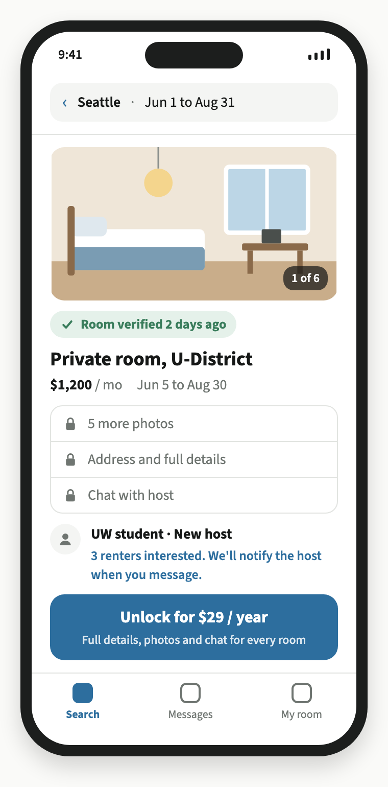
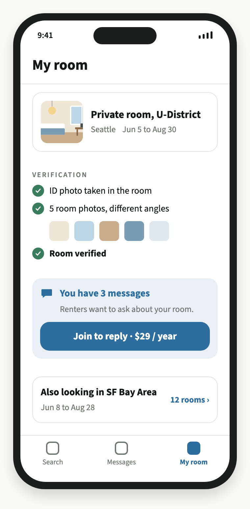

# SummerNest: Midterm Report

INFO 6215, Fall 2026
Xiaoyu Wang and Aurora Ouyang
October 29, 2026

---

## 1. Product Articulation

### Why we started

We watched a classmate look for a summer sublet in another city. They spent hours in Facebook groups and on RedNote, scrolling past posts with the wrong dates and trying to guess which rooms were real. Most posts failed one test or the other. We thought: what if every room was already verified and already filtered by your dates? That is SummerNest.

### Product description

SummerNest is a verified sublet marketplace for students who move to another city for a summer internship. Hosts list their empty room for free and verify it by uploading a photo of themselves holding their ID inside the room, plus five photos from different angles. Our team reviews each one by hand. Renters search by city and dates and see a free preview: a summary, one cover photo and a "Room verified ✓" badge. A $29 one-year membership unlocks all photos, full details and chat. One membership covers both roles, because many of our users are both: a student leaving Seattle for an SF internship has a room to fill in Seattle and needs one in SF. The sublease itself is arranged directly between members.

### Customer segments

| | Segment 1: Interns moving to a new city (renters) | Segment 2: Students leaving for the summer (hosts) |
|---|---|---|
| Job to be done | Find a room near my internship for exactly my dates, before I arrive | Cover my rent while I'm away, with someone I trust in my room |
| Pains (worst first) | Scams and fake listings; can't see the room before paying; dates rarely line up | Paying rent on an empty room; endless messages and no-shows; not knowing who moves in |
| Gains | Housing locked in before day one; move in with just a suitcase; short commute | Money toward my own internship move; a tenant with a similar lifestyle; deal done in days, not weeks |
| Value proposition | Verified rooms that match your dates, from anywhere | Fill your room with a verified intern whose dates match |

**Supply-demand overlap.** The same student is often a renter in City B and a host in City A. One sign-up can add both supply and demand, which is how we plan to handle the cold-start problem in a two-sided marketplace. We have not tested this yet (see Riskiest Assumption R2).

### Competition and alternatives

| | Verified identity | Date matching | Close to your work | Built for 2 to 4 months | Low cost | Open to any student intern | English & international |
|---|---|---|---|---|---|---|---|
| Facebook groups, Craigslist | ✕ | ✕ | ~ | ~ | ✓ | ✓ | ✓ |
| RedNote | ✕ | ✕ | ~ | ~ | ✓ | ✓ | ~ |
| Airbnb (monthly) | ✓ | ✓ | ✓ | ✕ | ✕ | ✓ | ✓ |
| Furnished Finder | ✓ | ~ | ~ | ✓ | ~ | ✓ | ✓ |
| Extended-stay hotels | ✓ | ✓ | ~ | ✓ | ✕ | ✓ | ✓ |
| Company-provided housing | ✓ | ✓ | ✓ | ✓ | ✓ | ✕ | ✓ |
| University summer housing | ✓ | ~ | ✕ | ✓ | ~ | ✕ | ✓ |
| Friends and alumni | ✓ | ✕ | ✕ | ~ | ✓ | ✕ | ~ |
| **SummerNest** | ✓ | ✓ | ✓ | ✓ | ✓ | ~ | ✓ |

✓ yes, ~ partly, ✕ no. SummerNest is ~ on "open to any student intern" because launch covers students at 6 schools in two cities. More schools and cities come after the MVP.

**What the table does not show.** Each alternative has a real strength:
- Free boards are free and already have the users. This is our biggest threat and the reason willingness to pay is R1.
- Airbnb has years of trust, reviews and payment protection that we do not have.
- Company housing is the best option for the interns who get it. Our market is the interns who don't.
- Kopa (formerly PadPiper, SF, 2016), a verified medium-term housing marketplace, has shut down (per kopa.co). A similar idea has failed before, so our riskiest assumptions need testing before we build more.

**Positioning:** verified rooms like Airbnb, at student-to-student rent, for students moving between Seattle and the Bay Area.

---

## 2. Business Case

### Model scope

- Period: Year 1 = summer 2027 (search season January to May, stays June to August)
- Launch: one city pair, 6 schools
  - Seattle: UW Seattle, Northeastern Seattle
  - SF Bay Area: SF State, USF, UC Berkeley, Stanford
- Price: posting and room verification are free. A $29 one-year membership unlocks full listings and chat. Both renters and hosts need it to send or reply to messages.
- Founders unpaid in Year 1; room verification done by the founders

### Revenue funnel

| Step | Rate | Source | Users |
|---|---|---|---|
| Students at 6 launch schools | Seattle 53.8k + SF Bay Area 94.3k | School enrollment reports, 2023 to 2025 | 148,100 |
| Do a summer internship that year | 30% | Estimate. NACE: 67% of Class of 2024 seniors interned at least once during college | 44,430 |
| Relocate to another city for it | 40% | Estimate | 17,772 |
| Sign up with school email (free) | 15% | Estimate | 2,666 |
| Buy a $29 membership | 30% | Estimate, supported by our survey (below) | 800 |

The relocation step counts every student who moves for an internship, while the MVP serves only moves between Seattle and the Bay Area. This is a first estimate. The MVP data will show the real share of users in our city pair (see Limitations).

### Why 30% conversion

- **Early survey.** We surveyed and interviewed 30 people. 11 of them (37%) said they would pay $29 for verified, date-matched listings. Stated intent usually runs higher than real payment, so we set our base case at 30%, below what people told us.
- **High intent.** People who sign up already have an internship offer in another city and a move-in date. They are early adopters with an urgent problem, the customers Ries says a new product should serve first (Ch. 6, p. 96-97). Most free apps have casual browsers; we don't.
- **Pay at the right moment.** Users see the paywall only after a free preview shows them a verified room that matches their dates. They pay once they have found something they want.
- **Small next to the stakes.** $29 is less than 1% of a summer's rent for a room at $1,500 a month, and far less than losing a deposit to a scam.
- **Still a hypothesis.** 30% is our target, and it is the number our MVP tests (R1). The sensitivity table shows what happens if it is lower.

### Year 1 P&L

| Line | Calculation | Year 1 |
|---|---|---|
| **Revenue** | 800 × $29 | **$23,200** |
| Payment processing | 2.9% + $0.30 per charge = $1.14 × 800 (Stripe) | ($913) |
| Customer support | $1 per member (estimate) | ($800) |
| **Gross profit** | 93% margin | **$21,487** |
| Campus ambassadors | 6 × $500 (estimate) | ($3,000) |
| Social ads | Estimate | ($3,000) |
| Hosting and software | ~$175 / month (estimate) | ($2,100) |
| Legal review of terms (one time) | Estimate | ($2,000) |
| **Operating profit** | 49% margin | **$11,387** |

No paid ID checks: sign-up uses a school email, and the founders review room verification by hand. One ambassador per school.

**Key ratios**
- Contribution per member: $26.86 ($29 minus $1.14 Stripe and $1 support)
- Fixed costs: $10,100
- Break-even: about 376 members, or 14.1% of sign-ups paying
- CAC (marketing ÷ members): $7.50, against a lifetime value of about one membership ($29)

### Sensitivity: conversion drives the result

| Sign-up to paid | Members | Operating profit |
|---|---|---|
| 30% (base) | 800 | +$11,387 |
| 15% | 400 | +$644 |
| 14.1% (break-even) | 376 | ~$0 |
| 5% | 133 | −$6,528 |

Break-even at 14.1% leaves little room for error on willingness to pay. This is why R1 ranks first.

### Benchmarks: what users pay elsewhere

- Facebook groups, Craigslist, RedNote: free
- Furnished Finder: landlords pay $199 per year per listing (from January 2, 2026); no commission; tenants free, with optional $44.99 KeyCheck screening
- Airbnb: free to list; most hosts moved to a single host-only fee of about 15.5% in late 2025. On a $1,500/month room for 3 months, that is about $700.
- SummerNest at $29 a year sits close to the free options and far below the paid ones.

### Riskiest assumptions

Ranked by impact on the P&L × how little evidence we have. These are our leap-of-faith assumptions: R1 is a value hypothesis, R2 and R3 are growth hypotheses (Ries, Ch. 5).

**R1. Users will pay $29 when Facebook and RedNote are free.**
Conversion is the biggest driver of revenue. Below 14.1% we lose money. Every alternative for this group is free. Our only evidence so far is what 30 people told us, not what they did, and Kopa's shutdown shows the risk is real.

**R2. Each city has enough verified rooms for the right dates (liquidity).**
A member who finds no match gets nothing for $29, asks for a refund and won't recommend us. Our plan depends on overlap: students leaving Seattle for SF list their Seattle room. We assume about 40% of members both list and rent (estimate). If overlap is low, both cities start cold.

**R3. We can reach relocating interns cheaply in a short window.**
Students need us once or twice in college, so lifetime value is about $29. CAC has to stay well below that. The search season is about four months a year, so a channel that fails costs us a whole season.

---

## 3. MVP

### MVP definition

A Wizard of Oz web app: verified students in Seattle and the SF Bay Area list rooms for free and search by date. A $29-a-year membership unlocks full listings and chat. Users see a working product. Behind it, our team reviews every room verification by hand. Ries describes the same approach with Aardvark, which ran parts of its back end with people for months before automating (Ch. 6, p. 104-108).

Because we are F-1 students, we will not collect real money in this class project. The "Unlock for $29" and "Join to reply" buttons are fake doors: they record the click and tell the user that membership is not open yet. This measures purchase intent, not payment (see Limitations).

### Key requirements and prioritization

Must-have = high importance + low or medium build cost.

| # | Must-have | Details | Why it matters | Build cost | Risk |
|---|---|---|---|---|---|
| 1 | Room verification | Host uploads a photo holding their ID inside the room, plus 5 photos from different angles. Team reviews by hand; passing gives "Room verified ✓" | Stops scams, the #1 pain for renters | Low: an upload form plus our time | R1 |
| 2 | Free listing | City, dates, rent, room type, summary, photos. Optional field: "I'm also looking for a room in ___" | Builds supply; the extra field measures overlap | Low | R2 |
| 3 | Date search | Filter by city, date range, max rent. Free preview: summary, cover photo, verified badge | Matches internship dates; lets renters see the room is real before paying | Medium | R2 |
| 4 | $29/year membership (fake door) | "Unlock for $29" on every listing; "Join to reply" for hosts with messages | Our only revenue, and the test for R1 | Low | R1 |
| 5 | Member chat | Only members can send or reply. Listing shows "Host replies on SummerNest" when the host is a member. Non-member hosts see "You have N messages. Join to reply" | What users pay for; asks hosts to pay when their intent is highest | Medium | R1 |
| 6 | .edu sign-up | School email from the 6 pilot schools | Verifies students for free; reaches users through campuses | Low | R3 |

**Later** (lower importance or higher cost): LinkedIn or ID check for non-students, reviews after a stay, automatic matching, more cities, mobile app, real payments.

### Design choices and rationale

| Design choice | Rationale | Risk |
|---|---|---|
| One city pair: Seattle ↔ SF Bay Area | Overlap only works between two cities. One pair builds enough listings faster than four cities | R2 |
| Free to post, pay to contact | Supply first. Users pay at the moment they want something: a renter who found a room, or a host with messages waiting | R1, R2 |
| One free cover photo + verified badge | Renters can see the room is real before paying, which answers "can't see the room" | R1 |
| Verify the room, not only the person | School email proves who someone is. The ID-in-room photo proves they are in that room now | R1 |
| Manual review | Cheapest way to offer verification at launch. Automate only if users value it | R1 |
| Students only, via 6 campuses | Campus channels are cheap to reach, and .edu email verifies students for free | R3 |

**Why hosts also pay to reply.** Listings are a top risk (R2), so we kept everything that creates a listing free: posting, verification and the "Room verified ✓" badge. Renters see every verified room whether or not the host is a member. The paywall only starts when a host has renters waiting:
- Hosts pay at the moment they have proof of demand ("You have 3 messages"), not before.
- Many hosts are also renters in the other city, and one $29 covers both roles.
- Paying hosts are committed and more likely to reply. The "Host replies on SummerNest" label tells renters which hosts can answer before they pay.
- Revenue from both sides gives more room above our 14.1% break-even.

The risk is that hosts with messages leave instead of paying. The MVP measures this directly: the share of hosts with messages who click "Join to reply." If it is low, we let hosts reply for free and charge renters only.

### MVP prototype

*Renter view: search by city and dates, free preview with one cover photo and the verified badge, "Unlock for $29" for full details and chat.*

*Host view: verification status, waiting messages with "Join to reply · $29 / year", and the host's own search in the other city.*

---

## 4. Build-Measure-Learn Project Plan (one cycle)

### Learning plan

| Hypothesis | What we test | Approach |
|---|---|---|
| R1 Willingness to pay | Verified users click "Unlock for $29" when free boards exist, and hosts with messages click "Join to reply" | Fake-door buttons in the live MVP (smoke test, Ch. 7, p. 118-119), plus a short exit survey for users who don't click: "What would make this worth $29?" |
| R2 Liquidity and overlap | Hosts list and finish room verification; renters find a room that matches their dates; some users do both | MVP listing data: optional "I'm also looking for a room in ___" field, verification completion, date-match rate per search |
| R3 Cheap reach | Campus channels bring sign-ups at a low cost per user | One campus ambassador at Northeastern Seattle and one at UC Berkeley, each with a unique sign-up link; compare with a small social ad test |

Our survey of 30 people told us what people say. The MVP tests what they do: clicks, listings and sign-ups. Interviews and the exit survey explain the numbers but do not replace them.

### Metrics for success

Most thresholds come from the P&L: we need about 14.1% of sign-ups to pay to break even, and CAC must stay near $7.50 per member, about $2.25 per sign-up at 30% conversion. The host threshold has no P&L anchor yet, so it is a team target.

| Hypothesis | Actionable metric | Persevere if | Pivot or rethink if |
|---|---|---|---|
| R1 | % of verified sign-ups who click "Unlock for $29" | ≥ 15% | < 8% |
| R1 | % of hosts with at least 1 message who click "Join to reply" | ≥ 25% | < 10% (switch to free host replies) |
| R2 | % of hosts who finish room verification | ≥ 60% | < 30% |
| R2 | % of renter searches with at least 1 verified room matching the dates | ≥ 50% | < 20% |
| R2 | % of sign-ups who both list and search (overlap) | ≥ 25% | < 10% |
| R3 | Marketing cost per verified sign-up | ≤ $2.25 | > $5 |

Results between the two columns mean "iterate": change one thing (price, preview, message copy) and run the cycle again. We track results by weekly cohort, not cumulative totals, so a good week of ads cannot hide a falling conversion rate (Ch. 7, p. 123-124 and p. 128-130).

### Timeline (search season 2027)

| Week | Dates | Phase | Milestone |
|---|---|---|---|
| 1 to 2 | Jan 4 to Jan 17 | Build | Web app live: sign-up, listing, verification upload, date search, fake doors, chat. Recruit 2 ambassadors |
| 3 to 4 | Jan 18 to Jan 31 | Measure: supply | Ambassadors and our own networks recruit hosts. Target: 30 verified rooms per city before pushing renters |
| 5 to 8 | Feb 1 to Feb 28 | Measure: demand | Open search to renters; social ad test in week 6. Weekly cohort report every Monday |
| 9 | Mar 1 to Mar 7 | Learn | Analyze cohorts, interview 10 users (5 who clicked "Unlock," 5 who didn't) |
| 9 | Mar 8 | Decide | Pivot or persevere meeting (Ch. 8, p. 161). Decide on R1 to R3 and plan the next cycle |

This leaves March to May, the rest of the search season, for a second cycle.

### Budget (estimate)

| Item | Cost |
|---|---|
| Campus ambassadors, 2 × $250 for 6 weeks | $500 |
| Social ad test (Instagram, RedNote) | $300 |
| Domain and hosting (no-code web app) | $50 |
| Survey and analytics tools | $0 (free tiers) |
| **Total** | **$850** |

Room verification and support are done by the two founders, about 5 hours a week each (estimate).

### Critical path

Supply has to come before demand. Renters who search an empty site in week 5 will not come back. So the critical path is: verification flow working (week 2) → 30 verified rooms per city (week 4) → renter launch (week 5). If the room target slips, renter launch slips with it.

### Risk mitigation

| Risk | Mitigation |
|---|---|
| Too few hosts by week 4 | Post in existing Facebook and RedNote housing groups inviting hosts to list for free; delay renter launch by one week |
| Hosts quit during verification | Track where they drop off; if under 30% finish, test 3 photos instead of 5 |
| Hosts with messages won't pay to reply | If under 10% click "Join to reply," let hosts reply for free in the next cycle |
| Fake door frustrates users | Clear message after the click ("Membership opens soon, you're on the list"), and give testers free full access as thanks |
| Scams or fake listings get through | Manual review of every room; remove and block any listing that fails |
| Founders can't keep up with review | Cap the test at the 6 schools; pause new hosts if the queue passes 48 hours |

### Limitations

- A click on a fake door is not a payment. Real conversion will likely be lower, so a result near 15% is a weak pass.
- Our survey is small (30 people) and measures stated intent.
- The funnel's relocation rate (40%) counts all moves, not only Seattle ↔ Bay Area moves, so Year 1 members may be lower than 800.
- Two ambassador schools may not represent all 6.
- Overlap within one city pair may not hold for other pairs.

---

## Sources

- Ries, Eric. *The Lean Startup*. Crown Business, 2011, ch. 5 to 8.
- NACE, 2024 Student Survey: https://naceweb.org/job-market/internships/students-recognize-the-importance-of-gaining-internship-experience
- Enrollment (6 schools):
  - UW Seattle (Autumn 2025): https://www.washington.edu/news/2025/10/30/washington-residents-make-up-nearly-two-thirds-of-incoming-class-as-enrollment-increases-across-all-three-uw-campuses/
  - Northeastern Seattle (~1,500, 2023): https://news.northeastern.edu/2023/11/21/seattle-campus-10-year-anniversary/
  - SF State (~20,700, Fall 2025): https://goldengatexpress.org/113580/campus/a-one-sided-enrollment-battle-sjsu-booms-while-sfsu-shrinks/
  - USF (8,796, 2025): https://www.usfca.edu/
  - UC Berkeley (Fall 2025): https://opa.berkeley.edu/campus-data/uc-berkeley-quick-facts
  - Stanford (18,625, Fall 2024, Common Data Set 2024-25, B1): https://irds.stanford.edu/data-findings/cds
- Stripe pricing: https://stripe.com/pricing
- Furnished Finder 2026 pricing: https://support.furnishedfinder.com/hc/en-us/articles/43700974504475-Furnished-Finder-2026-Pricing
- Airbnb host-only fee change (secondary source): https://www.hostaway.com/airbnb-host-only-fee-what-to-know-about-the-15-percent-host-fee
- Kopa: https://kopa.co
- SummerNest team survey and interviews, 30 respondents, October 2026.
- AI use: "Draft the Midterm Report for SummerNest, a verified sublet marketplace for interns" prompt. Claude, Opus 5.5 version, Anthropic, 27 Oct. 2026, claude.ai.
